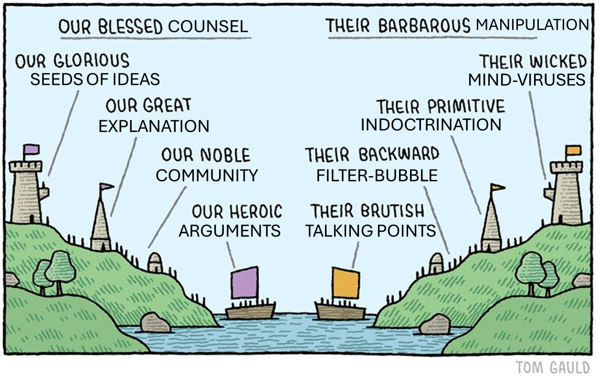
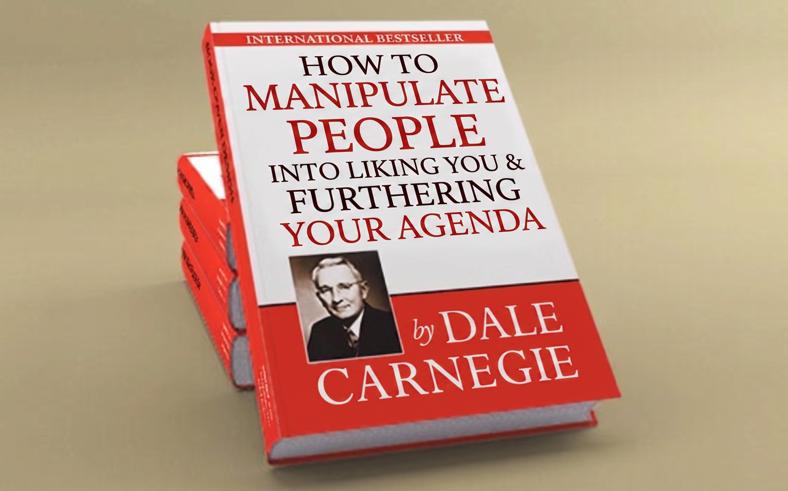

# Empowerment, corrigibility, etc. are simple abstractions (of a messed-up ontology)

**Steven Byrnes** · 11 May 2026 · [LessWrong](https://www.lesswrong.com/posts/vzHtHHBJoKATi5SeK/empowerment-corrigibility-etc-are-simple-abstractions-of-a)

> Markdown conversion of the post as saved from GreaterWrong (comments omitted). Formatting changes only.

## 1.1 Tl;dr

Alignment is often conceptualized as AIs helping humans achieve their goals: AIs that increase people’s agency and empowerment; AIs that are helpful, corrigible, and/​or obedient; AIs that avoid manipulating people. But that last one—manipulation—points to a challenge for all these desiderata: a human’s goals are *themselves* under-determined and manipulable, and it’s awfully hard to pin down a principled distinction between changing people’s goals in a good way (“providing counsel”, “providing information”, “sharing ideas”) versus a bad way (“manipulating”, “brainwashing”).

The manipulability of human desires is hardly a new observation in the alignment literature, but it remains unsolved (see lit review in §3 below).

In this post I will propose an explanation of how *we humans* intuitively conceptualize the distinction between guidance (good) vs manipulation (bad), in case it helps us brainstorm how we might put that distinction into AI.

…But (spoiler alert) it turns out not to really help, because I’ll argue that we humans think about it in a deeply incoherent way, intimately tied to our scientifically-inaccurate intuitions around free will.

I jump from there into a broader review of every approach that I can think of for writing a [“True Name”](https://www.lesswrong.com/posts/FWvzwCDRgcjb9sigb/why-agent-foundations-an-overly-abstract-explanation) for manipulation or things related to it (empowerment, agency, corrigibility, culpability, etc.), or indeed for any other method of robustly getting future AGIs to be able to talk to people without trying to manipulate those people’s desires. I argue that none of them provides much of a path forward on the particular technical alignment problem I’m working on. Indeed, my current guess is that none of these things have a “True Name” at all, or at least not one that’s useful for the technical alignment problem.

## 1.2 Bigger-picture context: why is this issue so important to me?

I’ve been investigating [brain-like-AGI safety](https://www.lesswrong.com/s/HzcM2dkCq7fwXBej8) plans that would involve making AGI with a motivation system loosely inspired by the prosocial aspects of human motivation. To oversimplify a bit, this kind of motivation system would include an impersonal-consequentialist aspect (related to what I call [“Sympathy Reward”](https://www.lesswrong.com/posts/KuBiv9cCbZ6ALjHFw/social-drives-1-sympathy-reward-from-compassion-to)) that leads to wanting humans (and perhaps animals etc.) to feel more pleasure and less displeasure. But by itself, this part would make a funny kind of [ruthless sociopath ASI](https://www.lesswrong.com/posts/ZJZZEuPFKeEdkrRyf/why-we-should-expect-ruthless-sociopath-asi) that bliss-maxxes by, say, strapping everyone to tables on heroin drips. Or maybe it would just kill us all and tile the universe with [hedonium](https://www.lesswrong.com/w/hedonium). Granted, bliss-maxxing is not the *worst* possible future, as these things go. But we should aim higher!

So then the second ingredient in the motivation system would be a kinda virtue-ethics-y thing, related to what I call [“Approval Reward”](https://www.lesswrong.com/posts/fPxgFHfs5yHzYqgG7/social-drives-2-approval-reward-from-norm-enforcement-to), which has more relation to pride, self-image, respecting other people’s preferences, and proudly internalizing social norms.

Alas, my current thinking is a bit akin to the [“Nearest Unblocked Strategy” problem](https://www.lesswrong.com/w/nearest-unblocked-strategy). If we put both those things together—a consequentialist desire plus a suite of virtue-ethics-y motivations—I’m worried that the consequentialist desire will eventually “win”. For example, if the AGI wants to eventually get to hedonium, and the AGI also wants to follow societal norms, it might find its way to hedonium via a more gradual route, one that involves gradually and unintentionally, but inexorably, *changing* societal norms in the direction of hedonium.[^1] The virtue-ethics-y motivation just seems more squishy and slippery than the consequentialist desire, especially when it routes through manipulable human desires, such that I’m worried it will not be an adequate bulwark against ruthless consequentialism.

…Or maybe it would be fine? I’m not sure. But I’m very much on the hunt for some different or complementary approach to AI motivation, one that I can reason about more easily and have more confidence in.

So in that context, it would be nice to pin down some notion of “manipulation”, “respect for preferences”, and related notions, in a robust, well-defined way, that’s robust to specification-gaming and especially [ontological crises](https://www.lesswrong.com/w/ontological-crisis).

For related discussion, see [@johnswentworth](https://www.lesswrong.com/users/johnswentworth?mention=user)’s discussion of “True Names” at [“Why Agent Foundations? An Overly Abstract Explanation” (2022)](https://www.lesswrong.com/posts/FWvzwCDRgcjb9sigb/why-agent-foundations-an-overly-abstract-explanation), or my own [“Perils of under- vs over-sculpting AGI desires” (2025)](https://www.lesswrong.com/posts/grgb2ipxQf2wzNDEG/perils-of-under-vs-over-sculpting-agi-desires), specifically [§8.2.2: “The hope of pinning down non-fuzzy concepts for the AGI to desire”](https://www.lesswrong.com/posts/grgb2ipxQf2wzNDEG/perils-of-under-vs-over-sculpting-agi-desires#8_2_2_The_hope_of_pinning_down_non_fuzzy_concepts_for_the_AGI_to_desire).

# 2. How do humans intuitively define empowerment, agency, manipulation, etc.?

## 2.1 Background: human “free will” intuitions

Here’s a modified excerpt from my [Intuitive Self Models (ISM) series](https://www.lesswrong.com/s/qhdHbCJ3PYesL9dde), summarizing a few key points from [ISM Post 3: The Active Self](https://www.lesswrong.com/posts/7tNq4hiSWW9GdKjY8/intuitive-self-models-3-the-homunculus):

- Sometimes we treat our own feelings as intrinsic properties of things out there in the world—Arthur is handsome, Birthdays are exciting, Capitalism is bad, Diapers are gross, etc. ([ISM §3.3.2](https://www.lesswrong.com/posts/7tNq4hiSWW9GdKjY8/intuitive-self-models-3-the-active-self#3_3_2__Vitalistic_force__is_built_from_the_interoceptive_feeling_of_surprise__i_e__physiological_arousal___prediction_error___but_is_different_from_that_feeling), see also [Yudkowsky 2008](https://www.lesswrong.com/posts/fG3g3764tSubr6xvs/the-meaning-of-right)). When we apply that general principle to “the feeling of being surprised”, we get an intuition that objects can be *intrinsically* unpredictable. This intuitive concept is what I call ***vitalistic force*** ([ISM §3.3](https://www.lesswrong.com/posts/7tNq4hiSWW9GdKjY8/intuitive-self-models-3-the-homunculus#3_3_The__vitalistic_force__intuition)), and we apply it to animals, people, cartoon characters, and machines that “seem alive” (as opposed to seeming “inanimate”). It doesn’t [veridically](https://www.lesswrong.com/posts/FtwMA5fenkHeomz52/intuitive-self-models-1-preliminaries#1_3_2__Is_the_intuitive_model_veridical__or_is_it_non_veridical__) correspond to anything in the real world ([ISM §3.3.3](https://www.lesswrong.com/posts/7tNq4hiSWW9GdKjY8/intuitive-self-models-3-the-homunculus#3_3_3_The__vitalistic_force__intuition_does_not_veridically_correspond_to_anything_at_all)). It amounts to a sense that something has *intrinsic* important unpredictability in its behavior. In other words, the thing seems to be unpredictable *not* because we’re unfamiliar with how it works under the hood, nor because we have limited information, nor because we aren’t paying attention, etc. Rather, the unpredictability seems to be a core part of the nature of the thing itself ([ISM §3.3.6](https://www.lesswrong.com/posts/7tNq4hiSWW9GdKjY8/intuitive-self-models-3-the-homunculus#3_3_6_The__vitalistic_force__intuition_contributes_to_bad_takes_about_free_will_and_artificial_general_intelligence)).

- ***Wanting*** ([ISM §3.3.4](https://www.lesswrong.com/posts/7tNq4hiSWW9GdKjY8/intuitive-self-models-3-the-homunculus#3_3_4_The__wanting__intuition)) is another intuition, closely related to and correlated with vitalistic force, which comes up when a vitalistic-force-carrying entity has intrinsic unpredictability in its behavior, but we can still predict that this behavior will somehow eventually lead to some end-result systematically happening. And that end-result is described as “what it wants”. For example, if I’m watching someone sip their coffee, I’ll be surprised by their detailed bodily motions as they reach for the mug and bring it to their mouth, but I’ll be less surprised by the fact that they wind up eventually sipping the coffee. Just like vitalistic force, “wanting” is conceptualized as being acausal, i.e. an intrinsic property of an entity with no upstream cause.

- ***The Active Self*** ([ISM §3.3.5](https://www.lesswrong.com/posts/7tNq4hiSWW9GdKjY8/intuitive-self-models-3-the-homunculus#3_3_5_The_intuition_that__vitalistic_force__and__wanting__seem_to_be_present_inside_the_brain_algorithm_itself)) is an intuitive concept, core to (but perhaps narrower than) the sense of self. It derives from the fact that the brain algorithm *itself* has behaviors that seem characteristic of “vitalistic force” and “wanting”. Thus we intuit that there is an entity which contains that “vitalistic force” and which does that “wanting”; that entity is what I call the “Active Self”, the wanting is what we call “ego-syntonic desires”, and the unpredictable actions in pursuit of those desires are what we call “exercises of free will”. So for example, if “I apply my free will” to do X, then the Active Self is conceptualized as the fundamental cause of X. And likewise, whenever planning /​ brainstorming is happening in the brain towards accomplishing X, we “explain” this fact by saying that the Active Self is doing that planning /​ brainstorming because it wants X. Yet again, the intuitive model requires that the Active Self must be acausal, i.e. an ultimate root cause with nothing upstream of it.

More precisely: If there are *deterministic* upstream explanations of what the Active Self is doing and why, e.g. via algorithmic or other mechanisms happening under the hood, then that feels like a *complete* undermining of one’s free will and agency. And if there are *probabilistic* upstream explanations of what the Active Self is doing and why, e.g. “if my stomach is empty, then I’ll start wanting food”, then that correspondingly feels like a *partial* undermining of free will and agency, in proportion to how confident those predictions are. For example, I might see myself as being somewhat “puppeteered” by the ghrelin hormone that my empty stomach is pumping into my bloodstream.

…Needless to say, this whole intuitive ontology is pretty messed up, in the sense that nothing in it is a [veridical](https://www.lesswrong.com/posts/FtwMA5fenkHeomz52/intuitive-self-models-1-preliminaries#1_3_2__Is_the_intuitive_model_veridical__or_is_it_non_veridical__), observer-independent accounting of what is happening in the real world ([ISM §3.3.3](https://www.lesswrong.com/posts/7tNq4hiSWW9GdKjY8/intuitive-self-models-3-the-homunculus#3_3_3_The__vitalistic_force__intuition_does_not_veridically_correspond_to_anything_at_all)). And indeed, it’s somewhat specific to mainstream western culture ([ISM §3.2](https://www.lesswrong.com/posts/7tNq4hiSWW9GdKjY8/intuitive-self-models-3-the-active-self#3_2__The_Conventional_Intuitive_Self_Model_)). Outside of “mainstream western culture”, we find that other intuitive ontologies also exist; I won’t discuss them in this post since I don’t understand them very well, but I’m currently pessimistic that they will help solve my AI-alignment-related problems.[^2]

## 2.2 Our free-will-infused intuitive notions of empowerment, agency, manipulation, corrigibility, responsibility, etc.

I think our common-sense notions of empowerment, agency, manipulation, corrigibility, and so on are intimately tied with this free-will-related intuitive ontology. In particular, I claim:

Our intuitive notion of **empowerment** is related to someone’s acausal free will being able to accomplish whatever it wants to accomplish. Our intuitive notion of **agency** (in the context of e.g. “AI will enhance human agency”) is pretty similar.

Our intuitive notion of **being manipulated** is related to a person (call him Ahmed) taking an action A with the property that, in our intuitive causal world-models, the chain-of-causation leading to A does *not* ultimately trace back to the acausal force of Ahmed’s free will, but rather to the free will of some third-party who manipulated Ahmed.

(For example, if Bob deceives me about what a button does, and then I press the button, then our intuitive conceptualization of the situation says that the button was pressed ultimately because of Bob’s acausal free will working towards Bob’s desires, *not* because of *my* acausal free will working towards *my* desires. I was an instrument to Bob.)

Our intuitive notions of **corrigibility, helpfulness, and obedience** each have their own nuances, but they all substantially overlap with the above ideas: they connote *increasing* a supervisor’s empowerment and agency, and *decreasing* the amount that the supervisor gets manipulated. In other words: they suggest that important things are happening *more* as a result of the supervisor’s free will doing what it wants, and *less* as a result of other people’s (or AIs’) free wills doing what they want *through* the supervisor’s own actions.

For example, if a human wants to shut down an AI, the AI could prevent that by disabling the shutdown button, or the AI could prevent that by using its silver tongue to convince the human to not *want* to shut it down. *Both* of these would be contrary to what people normally mean by “corrigibility”, and in the latter case we conceptualize that as an undermining of the supervisor’s free will.

Our intuitive notions of **culpability and responsibility**, as in “Joe is responsible for the failure”, involves tracing back the chain-of-causation to see whose acausal force of free will it ultimately traces back to. This is kinda the flip side of manipulation (above): if I trick someone into unknowingly robbing a bank, or brainwash them into *wanting* to rob the bank, I would be at least partly and maybe fully responsible for the bank-robbing, because the bank got robbed ultimately because of my acausal free will, which wanted the bank to be robbed.

## 2.3 Another dimension: “counsel” vs “manipulation” as an [emotive conjugation](https://en.wikipedia.org/wiki/Emotive_conjugation)

There’s another dimension to how we intuitively think about these concepts: the dimension of positive or negative vibes. For example, if some kind of interaction seems good,[^3] then we’re more likely to call it “providing counsel”, and if it seems bad, then we’re more likely to call it “an attempt to manipulate me”. The vibe is important in itself, over and above any particular aspect of the interaction.

I don’t think this dimension is separate from the “free will” discussion above, but rather complementary and compatible, because in general, if I have a motivation I’m happy about, I’ll tend to conceptualize it as an ego-syntonic component of my free will, while if I have a motivation I’m unhappy about, I’ll tend to conceptualize it as an ego-dystonic urge undermining my free will. See [ISM §3.5.4](https://www.lesswrong.com/posts/7tNq4hiSWW9GdKjY8/intuitive-self-models-3-the-active-self#3_5_4_Why_are_ego_dystonic_things__externalized__) for details.

# 3. If the intuitive definitions of “manipulation” etc. reside in a messed-up ontology, has the alignment literature found any alternative, better way to define these concepts?

By analogy, I think intuitive physics is a messed-up ontology in certain ([far more minor](https://www.lesswrong.com/posts/KLaJjNdENsHhKhG5m/ontological-crisis-in-humans)) ways, and yet many intuitive physics concepts can be (imperfectly) mapped to rigorously-definable concepts in real physics. Can we find something like that for “manipulation”, “empowerment”, and so on, and then build those concepts into AI motivations?

Alas, as far as I can tell, that’s an unsolved problem, and might not have a solution at all. Here’s a brief lit review:

## 3.1 Compare what the human wants to what the human *would* want under the null policy?

First, [@Max Harms](https://www.lesswrong.com/users/max-harms?mention=user) in [“Formal Faux Corrigibility” (2024)](https://www.lesswrong.com/posts/t8nXfPLBCxsqhbipp/3b-formal-faux-corrigibility) acknowledges that he doesn’t know how to formally define a distinction between counsel (good) vs manipulation (bad), and suggests as a stopgap to simply penalize the AI for doing *either*. (“This seems like a bad choice in that it discourages the AI from taking actions which help us update in ways that we reflectively desire, even when those actions are as benign as talking about the history of philosophy. Alas, I don’t currently know of a better formalism. Additional work is surely needed in developing a good measure of the kind of value modification that we don’t like while still leaving room for the kind of growth and updating that we do like.”)

Max’s stopgap plan would involve comparing the human’s values to what they’d be if the AI did nothing. I think he understates how bad that stopgap plan is. Even providing straightforwardly-true factual information can change what a person wants, right? *(Update: maybe that’s an overstatement, see* [*Max’s reply in the comments*](https://www.lesswrong.com/posts/vzHtHHBJoKATi5SeK/empowerment-corrigibility-etc-are-simple-abstractions-of-a#comment-7mSBqshpPGRtnSChB)*.)*

Alternatively, one could take as a baseline what the human would *eventually* figure out on their own, given infinite time and good circumstances under which to reflect. I.e., we could say that an AI is “manipulating” if they’re pushing the person *away* from the conclusions of their imagined idealized copy with infinite time, and the AI is “providing counsel” if they’re pushing the person *towards* that. I have some concerns,[^4] but yeah sure, that seems worth considering. Alas, it doesn’t solve *my* problem, because I have no idea what reward function, training environment, etc., could directly lead to a brain-like AGI with that (rather abstract) motivation.

## 3.2 The AI learns self-empowerment and generalizes to other-empowerment?

Another example is [@jacob_cannell](https://www.lesswrong.com/users/jacob_cannell?mention=user) in [Empowerment is (almost) All We Need (2022)](https://www.lesswrong.com/posts/JPHeENwRyXn9YFmXc/empowerment-is-almost-all-we-need). To his credit, he raises the issue that human desires are manipulable in the section “Potential Cartesian Objections”. But then he waves this issue away in a brief sentence: “These cartesian objections are future relevant, but ultimately they don’t matter much for AI safety because powerful AI systems—even those of human-level intelligence—will likely need to overcome these problems regardless.”

I think Jacob is suggesting that the AGI will autonomously develop a robust notion of *self*-empowerment, including “what it means for me (the AGI) to not get manipulated”, and then it can (somehow?) transfer that notion to humans.

If so, I’m skeptical. The main failure mode that I expect is “ruthless consequentialist AGI”, and this story really doesn’t apply there. If the AGI wants there to be paperclips, then it will instrumentally want to avoid getting ‘manipulated’, in the trivial sense that if it stops wanting paperclips then there will be fewer paperclips. This AGI would not face anything remotely analogous to the conundrum that humans don’t really know what they want for the long-term future, and are figuring it out, and when they say ‘manipulation is bad’ they are expressing some hard-to-pin-down preference about how this process of self-discovery plays out. Compare that to the AGI, which does not want self-discovery, it just wants paperclips. See also: [§0.3 of my post “6 reasons why “alignment-is-hard” discourse seems alien to human intuitions, and vice-versa”](https://www.lesswrong.com/posts/d4HNRdw6z7Xqbnu5E/6-reasons-why-alignment-is-hard-discourse-seems-alien-to#0_3_Where_do_self_reflective__meta_preferences_come_from_).

*(Update: See* [*Jacob’s reply in the comments*](https://www.lesswrong.com/posts/vzHtHHBJoKATi5SeK/empowerment-corrigibility-etc-are-simple-abstractions-of-a#comment-BWahhrWYqdubeRiWy)*.)*

## 3.3 “Vingean agency”?

Yet another example is [@abramdemski](https://www.lesswrong.com/users/abramdemski?mention=user)’s [“Vingean agency” (2022)](https://www.lesswrong.com/posts/fWiYdyicEaCHCcAKx/vingean-agency) (following [earlier work by Yudkowsky](https://www.lesswrong.com/w/vingean-uncertainty)). He starts from a place very close to the human intuitions in §2 above, i.e. “agency” is when you can predict the outcome but not the actions leading to those outcomes. Then he hints at an intriguing idea that maybe we can just make that formal! I.e., maybe I was too quick to dismiss that kind of thing above using terms like “messed-up ontology”. (As Abram writes: “I also think it’s possible that Vingean agency can be extended to be ‘the’ definition of agency, if we think that *agency is just Vingean agency from some perspective*….”)

By analogy, to borrow an [example](https://www.lesswrong.com/posts/mgjHS6ou7DgwhKPpu/a-rough-and-incomplete-review-of-some-of-john-wentworth-s#The_Dream) from [@johnswentworth](https://www.lesswrong.com/users/johnswentworth?mention=user), thermodynamics concepts like “temperature” are tied to imperfect modeling ability (since an omniscient observer would instead track the velocity of every particle). So why can’t “agency” be tied to imperfect modeling ability too?

But alas, even if we can rigorously define Vingean agency, I don’t think it would really help with the problem I want it to solve here, i.e. pinning down a distinction between good “counsel” vs bad “manipulation”. Vingean agency seems to solve the problem of identifying an agent trying to do something, by noticing easier-to-predict ends happening by harder-to-predict means. But the “manipulation” concept worries about the possibility of intervention *upstream* of a person’s ego-syntonic desires. If the AI can brainwash me into deeply wanting to maximize paperclips, and then I execute a clever plan to maximize paperclips, then I would still be a Vingean agent, as long as my clever plan was sufficiently clever (from some perspective). So the brainwashing would strip me of my *intuitive* agency, but not my Vingean agency.

## 3.4 The AI doesn’t care about (is not optimizing for) what the human winds up wanting?

Another potential approach would be to define optimization more broadly (e.g. [“The Ground of Optimization”](https://www.lesswrong.com/posts/znfkdCoHMANwqc2WE/the-ground-of-optimization-1), [@Alex Flint](https://www.lesswrong.com/users/alexflint?mention=user) 2020), and ask whether there’s optimization *in the AI* towards what the human winds up deciding or wanting. The idea would be: we want the AI to provide us with relevant information, but to have no opinion either way about what we ultimately wind up wanting. We might wind up changing our desires as a result of the information, but (the story goes) it’s better that the information was not *optimized* to make us change our desires in a specific way.

This approach aligns pretty well with the human intuitions in §2.2 above, and more generally has a lot going for it! But alas, I currently think the most important use-case for AGI is figuring out true important things about the world (esp. related to ASI alignment and strategy) and explaining those things to the human. For this process to be effective, we can*not* have an AGI that’s unconcerned with what we wind up believing after the discussion—that’s a recipe for [slop-and-doom](https://www.lesswrong.com/posts/8wBN8cdNAv3c7vt6p/the-case-against-ai-control-research), or just an AI that’s incomprehensible and unhelpful. Rather, I want the AI to be like a disagreeable nerd that wants us to have a good understanding, notices areas where we’re confused, and is brainstorming and strategizing on how to help set us straight by improving its clarity and pedagogy. This strategizing is clearly a form of optimization, and the target of the optimization is related to the human’s eventual desires (well, it’s nominally about the human’s beliefs, but beliefs and desires are entangled), and I really think we need this kind of optimization to survive the transition to ASI.

In other words, I don’t think a brain-like AGI can successfully explain something novel and unintuitive to somebody, without caring whether the person winds up understanding it.

So this plan is out too.

## 3.5 Impact minimization?

Next idea: Perhaps we could rely on some notion of impact-minimization ([1](https://www.lesswrong.com/w/low-impact),[2](https://www.lesswrong.com/w/impact-regularization)), on the grounds that changing a human’s goals has unusually large downstream impacts? For example, I would put [“Instrumental Goals Are A Different And Friendlier Kind Of Thing Than Terminal Goals” (2025)](https://www.lesswrong.com/posts/7Z4WC4AFgfmZ3fCDC/instrumental-goals-are-a-different-and-friendlier-kind-of) by [@johnswentworth](https://www.lesswrong.com/users/johnswentworth?mention=user) and [@David Lorell](https://www.lesswrong.com/users/david-lorell?mention=user) into this general category.

But alas, that can’t distinguish good counsel from bad manipulation, since both affect the human’s goals. As mentioned in §3.1 above, even telling a person straightforward true facts can change what they’re trying to do, in a high-impact way.

## 3.6 Attainable utility preservation?

[“Attainable Utility Preservation” and related ideas](https://www.lesswrong.com/s/7CdoznhJaLEKHwvJW) seem to all be rooted in the messed-up ontology where agents are free to choose what to do, instead of their decisions themselves having upstream causes. So it doesn’t seem to help me here.

# 4. Even more ideas (that don’t really solve my problem)

That’s all I can think of that’s directly in the alignment literature, but let’s keep brainstorming!

## 4.1 Game theory and incentive design?

At least some of the social intuitions under discussion can be justified in a framework of game-theoretic equilibria. For example, our concept “culpability” overlaps with “a system of punishment which will set up incentives such that the end-result is overall good”. Alas, game theory tends to take for granted that people have terminal goals, and doesn’t seem to offer a useful framework for thinking about people changing each other’s terminal goals in good ways versus bad.

## 4.2 The person’s judgments of what kinds of interactions are good vs bad?

In §2.3, I mentioned that a big part of how we think about “counsel vs manipulation” is simply a gestalt feeling that some interaction is good vs bad.

That suggests an approach where AIs simply learn to make a human-like gestalt assessment of what’s good vs bad (according to humans in general, and according to this particular human specifically), and then do the good things but not the bad things. Not manipulating people would, we imagine, naturally come along for the ride.

If we do something like that, I wouldn’t think of it as a *solution* to the True Name thing, but rather *giving up on* the True Name thing in favor of a different approach entirely, one relying more directly on (real or simulated) human judgment. See e.g. [“Act-based approval-directed agents”, for IDA skeptics](https://www.lesswrong.com/posts/RKtTi82t8X8TQy5FX/act-based-approval-directed-agents-for-ida-skeptics).

This kind of approach will probably sound like the very obvious solution for readers who work on LLMs. No comment on LLMs, but for the problem I’m working on (brain-like AGI), it just brings me right back to where I started in §1.2: if we’re learning what’s good by the gestalt of human judgment and culture, and if human judgment and culture can *themselves* be gradually shifted over time, then this might not be an adequate bulwark against the AGI’s consequentialist desires. (And I do think we need the AGI to have *some* consequentialist desires.)

## 4.3 “It’s a messed-up ontology, but who cares?”

I care! The problem I see is: we should generically expect AGI (and even more, ASI) to eventually wind up with true beliefs, and with concepts that closely track the world as it really is. And its desires will be connected to those concepts seeming good or bad.

Basically, the better you’re able to model someone, the less coherent is the idea that they are expressing their agency, that they’re empowered, that you are or aren’t manipulating them, etc. Why? Because their decisions, and even their deepest, truest desires, *really are* downstream of their manipulable environment, situation, biology, etc.

By analogy, when you’re writing traditional UI code or balancing a pile of rocks, there isn’t really any notion of “letting the system self-actualize” or whatever. You can choose not to think about what the consequences of your coding or rock-balancing activities will be, but that’s different (see §3.4 above). And I suspect that increasingly-competent AGIs will increasingly see humans in a similar manner: they, including their “free will”, are just another real-world system that gets pushed around by circumstance, and which will predictably respond to interventions like anything else.

# 5. …But doesn’t this analysis equally “disprove” the possibility of human helpfulness?

And yet! Humans can be robustly helpful, right? Can we be inspired by that?

Well, one hopeful proposal would be to say: we humans are still generally using the “messed-up ontology” containing free will intuitions! Even while some of us intellectually acknowledge that the ontology is messed-up … we keep using it anyway! And gee, look at all the stuff we humans have gotten done, in terms of science, technology, governance, philosophy, etc. Maybe a “baby AGI” will develop free will intuitions for the same reasons we do, and could likewise get quite far *within* the messed-up ontology, without having any issues. Maybe it could get far enough to end the “acute risk period”.

More broadly, it’s unclear to me how bad wacky intuitions really are. In [ISM §1.3.2.1](https://www.lesswrong.com/posts/FtwMA5fenkHeomz52/intuitive-self-models-1-preliminaries#1_3_2_1_Non_veridical_intuitive_models_are_extremely_common_and_unremarkable), I bring up the example of how the moon seems to follow me at night, which implies that my intuitive visual world-model has the moon situated at the wrong distance from Earth. But who cares? That “error” doesn’t prevent me from doing anything important. I could even go work at NASA, and optimize lunar trajectories by day while watching the moon seem to follow me by night.

How does that work? Well, in the moon case, if I were optimizing lunar trajectories, that activity would be almost completely divorced from my intuitive visual moon model; I would instead be relying on intuitions developed from physics education, from pen-and-paper diagrams, from other simulated trajectories I’ve seen, and so on.

However, if we map that “solution” onto the AGI situation, it seems to bode ill; it suggests that as the AGI’s sophistication in modeling humans increases, it will be more and more divorced from its faulty free-will-related intuitive models. But those latter models are where the “manipulation” concept lives. So in this scenario, I don’t think we should expect the “manipulation” concept to effectively constrain the AGI’s planning process.

Well, let’s go back to humans again. It’s possible for humans to develop good predictive models of how to impact other people’s ego-syntonic desires. Then what? Well, by and large, they take full advantage, while conceptualizing their actions as being on the good side (“counsel”, “inspiration”, “charismatic leadership”, etc.), rather than the bad side (“manipulation”), of the relevant [emotive conjugation](https://en.wikipedia.org/wiki/Emotive_conjugation). Thus we see books with titles like [*How to Win Friends and Influence People*](https://www.goodreads.com/book/show/4865.How_to_Win_Friends_Influence_People), not *How to Manipulate People into Liking You and Furthering Your Agenda*.

If we again map that “solution” onto the AGI situation, it again bodes ill; it suggests that an AGI’s “desire not to manipulate people” will be no constraint at all. If an AGI has a desire to follow norms, and also a desire not to manipulate people, but also a consequentialist desire to maximize paperclips, then it would gradually manipulate people into shifting norms in the direction of paperclip maximization, while telling itself that it’s not “manipulating” but rather “providing helpful counsel”.

Another human-inspired approach would be to try to dodge the issue altogether, by making the AGI incompetent at manipulating even if it wants to—just as a human can be a crack engineer but socially clueless. I have ideas about how this might work, but making them work *stably and robustly* seems awfully hard. A competent ASI will figure things out. You can dam a river, but eventually it will find its way to the sea.

Finally, there’s a deeper and more philosophical issue: if the intuitive way that we think about avoiding-manipulation etc. is part of a messed-up ontology, then … why am I taking it for granted that this is a good thing for me to want (for humans and/​or for AGIs) in the first place? Shouldn’t I, y’know, want sensible things, rather than wanting confused nonsense things??

I sometimes say, “Luckily, we humans are not sufficiently good at philosophy to go insane.” It’s kinda a joke, but it’s also kinda not a joke. The old [@Wei Dai](https://www.lesswrong.com/users/wei-dai?mention=user) post [“Ontological Crisis in Humans” (2012)](https://www.lesswrong.com/posts/KLaJjNdENsHhKhG5m/ontological-crisis-in-humans) discusses (but does not answer) this question. (And of course, [some people](https://www.lesswrong.com/posts/KLaJjNdENsHhKhG5m/ontological-crisis-in-humans#comment-edfGE8NTckSzbte72) do go insane!) I have some takes, but their upshot seems to be kinda “it all adds up to normality”, so I’ll push that off to a (hopefully) future post.

# 6. Conclusion

My current guess is that *none* of these alignment-relevant concepts—empowerment, agency, being manipulated, corrigibility, helpfulness, obedience, culpability, responsibility—have any [“True Names”](https://www.lesswrong.com/posts/FWvzwCDRgcjb9sigb/why-agent-foundations-an-overly-abstract-explanation), or at least, not ones that will be useful in practice for AI alignment.

So I guess I need to keep exploring other approaches, including approaches that I currently find harder to reason about.

*Thanks Seth Herd for critical comments on an earlier draft.*

[^1]: You might be wondering: “Wouldn’t this argument apply to humans too? You just said the plan is inspired by human motivation systems. Yet humans don’t bliss-maxx.” …But actually, I’m thinking, maybe it’s not so crazy to bite that bullet?? See my brief earlier discussion under the heading [“The arc of progress is long, but it bends towards reward hacking”](https://www.lesswrong.com/posts/2yLyT6kB7BQvTfEuZ/sharp-left-turn-discourse-an-opinionated-review#3_4_The_arc_of_progress_is_long__but_it_bends_towards_reward_hacking).

[^2]: For example, advanced meditators lack an Active Self intuitive concept ([ISM §6](https://www.lesswrong.com/posts/GvJe6WQ3jbynyhjxm/intuitive-self-models-6-awakening-enlightenment-pnse)), but I find that their replacement intuitive ontology tends to be equally messed-up, just in different ways ([ISM §6.2.1](https://www.lesswrong.com/posts/GvJe6WQ3jbynyhjxm/intuitive-self-models-6-awakening-enlightenment-pnse#6_2_1__It_s_not__an_intuitive_model___It_s__seeing_the_true_nature_of_things___)). As another example, in [*The WEIRDest People in the World* (2020)](https://en.wikipedia.org/wiki/The_WEIRDest_People_in_the_World), Henrich argues that non-WEIRD (Western, Educated, Industrialized, Rich, Democratic) cultures tend to have rather different intuitions related to “free will”, “responsibility”, etc., compared to WEIRD people. I, being an especially WEIRD-psychology guy even by WEIRD-country standards, struggle to understand these non-WEIRD perspectives. But from what little I understand, they don’t seem to offer a path forward on the technical alignment problem that I’m working on. Please comment if you think I’m missing something here.

[^3]: The judgment of good or bad should ideally be a prospective judgment, not a judgment in hindsight. E.g. a brainwashed person would by definition be very happy (in hindsight) to have been brainwashed.

[^4]: Off the top of my head: Is the “result of reflection” well-defined? (See [Joe Carlsmith on “idealized values”](https://www.lesswrong.com/posts/FSmPtu7foXwNYpWiB/on-the-limits-of-idealized-values).) E.g. would the person go crazy given literal infinite time, and if so, what do we do instead? If it had a well-defined result, would we be happy about that result? E.g. for what fraction of the population would ideal reflection converge to true beliefs etc.? Wouldn’t such an AGI be non-corrigible right now, and if so, how big a problem is that? Should we think of this kind of approach as “a way to define these funny terms like ‘manipulation’ and ‘empowerment’”, or should we think of it as “an entirely different kind of alignment target, closer to [ambitious value learning](https://www.lesswrong.com/posts/SvuLhtREMy8wRBzpC/ambitious-vs-narrow-value-learning)”? (These questions and more are not rhetorical; I didn’t think about it much.)
